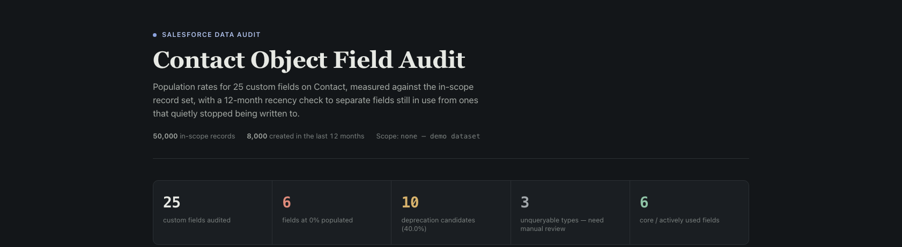

# salesforce-field-audit



A [Claude Code](https://claude.com/claude-code) skill that audits field usage
on any Salesforce object — which custom fields are actually populated, how
that's changed recently, and which ones are safe to deprecate.

Built after running it on a production Account object with ~300 custom
fields accumulated over a decade of integrations. It found that **38% of
those fields were dead, near-dead, or quietly abandoned**, and that most of
the dead weight traced back to a handful of decommissioned managed packages
rather than being spread evenly across the object.

## What it does

Given a Salesforce object, the skill:

1. Pulls the object's schema and extracts the custom field list.
2. Figures out (or asks) whether the object has an inactive/closed state to
   exclude from the denominator — a dead field on churned records reads very
   differently than a dead field org-wide.
3. Computes, for every field, the % of in-scope records where it's populated
   **all-time** and **in the last 12 months** — the second number is what
   catches a field that used to matter and quietly stopped.
4. Recovers population data for fields SOQL normally refuses to aggregate
   (formula/managed-package checkboxes) via a `WHERE field = true` fallback,
   instead of writing them off.
5. Categorizes every field (dead / near-dead / declining-legacy / core /
   needs manual review / etc.) and groups results by managed-package
   namespace, so "this integration left 40 dead fields behind" surfaces as
   clearly as any single field does.
6. Produces a Markdown findings report and a self-contained, searchable/
   sortable/filterable HTML field ledger.

The expensive part — hundreds of batched SOQL aggregate queries — is fanned
out across parallel subagents rather than run serially, which is most of why
a ~300-field object audit finishes in minutes instead of being impractical.

## Why it's a skill and not just a script

The live-query part (schema introspection, batched SOQL, recovering from
per-field aggregation errors, deciding what an "inactive" record looks like
on an object it's never seen) has to be driven by a model that can read the
schema, make judgment calls, and recover from Salesforce's various "this
field type can't be aggregated" errors. The deterministic part — thresholds,
package-namespace grouping, report rendering — is regular Python so it isn't
reinvented (or drifted) on every run. The skill is the glue: it tells the
agent exactly when to do which.

## Using it

Copy this folder into `.claude/skills/salesforce-field-audit/` (project- or
user-level), then in Claude Code:

```
Audit field usage on the Opportunity object
```

Claude Code will match the request to the skill, ask the scope questions in
`SKILL.md` (which org/connection, custom-only vs. all fields, how to define
"inactive"), and run the workflow — spawning subagents for the query
fan-out, then calling the bundled scripts to categorize and render the
report.

Requires a Salesforce MCP connection exposing `getObjectSchema` and
`soqlQuery` (read-only is sufficient — nothing here writes to the org).

## Running the report scripts standalone

The categorize/render steps don't need Claude Code or a live org — they just
need a JSON file of per-field population rows. Useful for regenerating a
report from previously-gathered numbers, or for extending the tool.

```bash
# rows.json: [{name, label, type, count_all, pct_all, count_recent,
#              pct_recent, note, description, inlineHelpText}, ...]
python3 scripts/categorize.py rows.json categorized.json

python3 scripts/render_markdown_report.py categorized.json findings.md \
  --object Contact --total-all 50000 --total-recent 8000

python3 scripts/render_html_report.py categorized.json report.html \
  --object Contact --total-all 50000 --total-recent 8000
```

## Example output

`examples/` contains a run against a synthetic Contact object (invented data
— no real org, company, or customer information) that exercises the same
patterns a real audit surfaces: dead fields, a field in decline as it's
replaced by a newer one, and a fully decommissioned managed package
(`LegacyCRM__*`) left behind after a migration.

- [`examples/sample-findings.md`](examples/sample-findings.md) — the
  Markdown report
- [`examples/sample-report.html`](examples/sample-report.html) — open this
  directly in a browser for the interactive, searchable/sortable ledger

## Project structure

```
SKILL.md                            # workflow the agent follows
scripts/
  categorize.py                     # thresholds + package-namespace grouping
  render_markdown_report.py         # findings.md generator
  render_html_report.py             # interactive HTML ledger generator
references/
  agent-prompt-template.md          # exact prompt used for the query fan-out
  categories.md                     # category thresholds and rationale
examples/
  sample-findings.md, sample-report.html, sample-categorized.json
```

## License

MIT — see [LICENSE](LICENSE).
